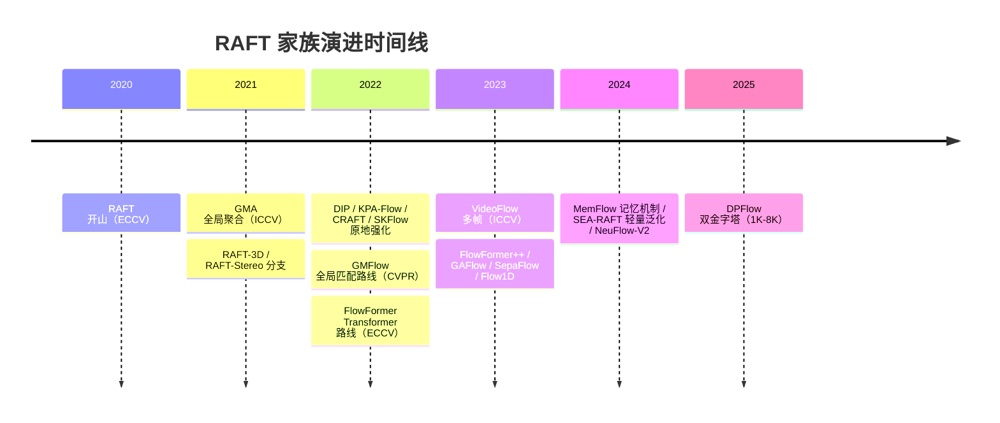
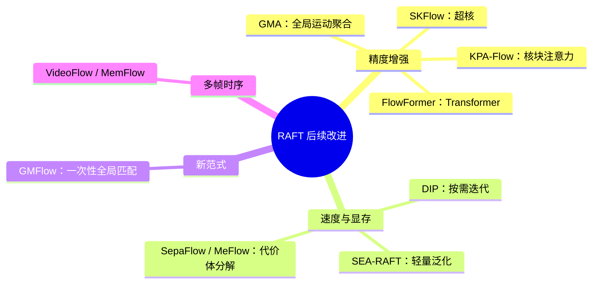
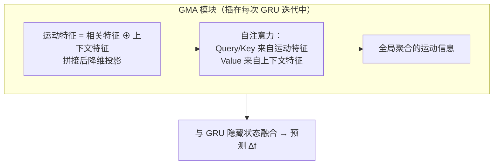

# RAFT 后续改进工作整理

> 承接 [RAFT论文解读](./RAFT论文解读.md)。这里梳理 RAFT（ECCV 2020）之后，光流社区在其基础上做的改进工作。
> 数值为 Sintel / KITTI 公开测试集上的报告值，不同来源（论文、榜单、微调设置）略有出入，看量级与趋势即可。

---

## 一、先回顾：RAFT 留下了哪几个"病根"？

后人改进 RAFT，基本都是冲着这三个痛点去的：

| RAFT 痛点 | 具体表现 | 对症下药的工作 |
|:---:|:---:|:---:|
| 🔴 4D 相关体显存爆炸 | $W\times H\times W\times H$ 二次方显存，大分辨率直接 OOM | GMFlow、CRAFT、SepaFlow、MeFlow、Flow1D |
| 🔴 固定迭代次数 | 每个像素不管难易都迭代 12+ 次，简单区域纯浪费 | DIP（按需收敛） |
| 🔴 局部查表搞不定遮挡/大位移 | 被挡住的像素在第二帧"查不到人"，本地方块里没有正确答案 | GMA、SKFlow、KPA-Flow |

另一个隐性问题：RAFT 只看两帧，时序信息完全没用上 → VideoFlow / MemFlow。

---

## 二、改进脉络总览

---

## 三、路线一：原地加强 RAFT（框架不动，补模块）

### GMA（ICCV 2021）—— 解决遮挡的"全局运动聚合"

[论文](https://arxiv.org/abs/2104.02409) | [代码](https://github.com/zacjiang/GMA)

**它解决什么问题？**
RAFT 的查表是**局部**的：每个像素只在第二帧对应位置的小窗口里找相似特征。像素一旦被遮挡，正确对应根本不在窗口里，怎么查都是错的 → 遮挡区域光流烂。

**核心想法：**
"我虽然看不见你，但世界上总有跟你长得像、运动也一致的像素。" —— 用**自注意力在整张图上找远距离依赖**，把全局运动信息聚合回来。模块插在 GRU 每次迭代里，不破坏 RAFT 原有结构。

**效果：** Sintel clean 1.61→**1.39**，final 2.86→**2.47**；遮挡区域误差降约 20%，非遮挡区域不受伤。代价是计算量变大（938G→1352G MACs）。

### SKFlow（NeurIPS 2022）—— 用"超核"同时捕捉全局与局部运动

[论文](https://arxiv.org/abs/2205.14623) | [代码](https://github.com/littlespray/SKFlow)

- **超核（super kernel）**：用"锥形连接 + 混合深度卷积"高效实现超大卷积核，扩大感受野；
- 自适应学习核权重，能动态在"全局运动模式"和"局部精细结构"之间切换，并做**遮挡感知推理 + 抗锯齿**；
- 发表时 Sintel 榜单**已发表方法第一**（clean 1.28 / final 2.23，KITTI 4.84），且鲁棒性在 RAFT 家族里最好。

### KPA-Flow（CVPR 2022）—— 在特征上做 patch 注意力

[论文](https://openaccess.thecvf.com/content/CVPR2022/html/Luo_Learning_Optical_Flow_With_Kernel_Patch_Attention_CVPR_2022_paper.html) | [代码](https://github.com/megvii-research/KPAFlow)

- GMA 是在"运动特征"上做全局注意力；KPA 改为在**特征图上按 patch 滑窗做核块注意力**，显式建模空间亲和性（相邻像素流动应平滑）；
- 效果：Sintel clean 1.35 / final 2.36，**KITTI 4.60**（当时新纪录）；
- 可插拔：是个可微分模块，能塞进任何迭代网络。

### DIP（CVPR 2022）—— 把"迭代 K 次"改成"求不动点"

[论文](https://arxiv.org/abs/2204.08442) | [代码](https://github.com/MrTornado24/deq-flow)

**它解决什么问题？** RAFT 固定迭代 12~100+ 次——简单像素 3 次就收敛了，后面的迭代纯浪费；训练时反向传播也要走完整个链，显存和时间都疼。

**核心想法：** RAFT 的迭代更新本质是在找不动点 $f^* = H(f^*, x)$。那不如直接用**黑盒求解器**（Anderson 加速等）按需收敛，并用隐函数定理求梯度。

**效果：**
- 训练显存从 $O(L)$ 降到 $O(1)$（L=迭代次数），约省 4~6 倍；
- 推理比同结构 RAFT 快约 20%；
- **模型无关**：RAFT、GMA 都能改成均衡形式，白捡加速。

### 其他原地强化

- **CRAFT**（CVPR 2022）：[论文](https://arxiv.org/abs/2203.16896) 用**交叉注意力 + 滑窗**计算相关，避免建完整 4D 体，省显存同时增强遮挡处理。
- **MS-RAFT+**（Jahedi 等）：多尺度输入 + 多尺度输出融合，**Robust Vision Challenge 2022 第一名**（KITTI Fl-all 4.15）。

---

## 四、路线二：掀桌子 —— 换掉 4D 相关体（GMFlow 系列）

### GMFlow（CVPR 2022）—— 一次性全局匹配，不要迭代

[论文](https://arxiv.org/abs/2111.13680) | [代码](https://github.com/haofeixu/gmflow)

**核心想法：**
1. 特征归一化后做**全局内积** → softmax 得到"匹配分布"（每个源像素在目标图上哪都匹配）；
2. 用匹配分布聚合目标特征 → 得到全局相关特征；
3. Swin 自注意力细化一次 → **直接输出光流**。

**没有 GRU、没有相关金字塔、一次前向出结果。**

**效果与代价：**
- 快、省显存（Sintel 上 138ms vs RAFT 141ms，显存更低）；
- 但初版精度掉队：Sintel 1.74/2.90，**KITTI 只有 9.32**（大位移+真实场景吃瘪）；
- 后续 **GMFlowNet / GMFlow+**（技术报告）加回归修正和卷积细化，追到 **1.03/2.37/4.49**，精度摸到第一梯队。

**它的意义：** 证明了"光流不一定非要迭代细化"。对运动简单、无遮挡的场景（比如文档矫正），这条"轻量一次前向"的路特别有吸引力。

---

## 五、路线三：Transformer 化 —— FlowFormer 系列

### FlowFormer（ECCV 2022）—— 把 4D 代价体喂给 Transformer

[论文](https://arxiv.org/abs/2203.16194) | [代码](https://github.com/drinkingcoder/FlowFormer-Official)

- 每个源像素的 2D cost map 用共享 latent codeword 压缩成 K 个 token → 紧凑的 latent 4D 代价体；
- **Alternating-Group Transformer（AGT）** 交替做"代价图内注意力"与"跨源像素空间注意力"，编码成 cost memory；
- **循环 Transformer 解码器**带动态位置查询，迭代修正光流；
- 效果：Sintel clean 1.16 / final 2.09（论文报告），泛化性强（只在合成数据上训练，Sintel clean 就 1.01）。

### FlowFormer++（CVPR 2023）—— 掩码代价体自编码预训练

[论文](https://arxiv.org/abs/2303.01237)

- **MCVA（Masked Cost Volume Autoencoding）** 自监督预训练 + 微调，把 FlowFormer 推到 **1.07/1.94/4.52**，Sintel final 一度第一；
- 代价惨重：1715G MACs、1080p 在 24GB 卡上**直接 OOM**。精度与显存的天平彻底倒向精度。

### GAFlow（ICCV 2023）—— 高斯注意力

[论文](https://mlanthology.org/iccv/2023/luo2023iccv-gaflow/) | [代码](https://github.com/LA30/GAFlow)

- 高斯约束层（GCL）+ 高斯引导注意力（GGAM）：给注意力加"局部优先"的高斯先验，增强局部判别和运动平滑；
- 精度、泛化、鲁棒性**三项均衡**（Sintel 1.15/2.05，KITTI 4.42）。

---

## 六、路线四：省内存 / 提效率 —— 高分辨率实战

4D 相关体的二次方显存是 RAFT 家族的死穴，一批工作专门治它：

| 工作 | 年份 | 思路 | 效果 |
|:---:|:---:|:---:|:---:|
| **SepaFlow** | ICCV 2023 | 把 4D 体拆成"全局空间代价体（降采样）+ 局部匹配代价体（全分辨率小窗）" | 显存从 $O(H^2W^2)$ 降到 $O(HW)$，精度仍第一梯队 |
| **Flow1D / HiFlow** | CVPR 2023 | 用 1D 注意力做高分辨率匹配 | 首批能跑 4K 的光流方法 |
| **MeFlow** | [arXiv 2312.03790](https://arxiv.org/abs/2312.03790) | 半径分布正交代价体 | 比 RAFT 省约 6 倍显存，4K 只需 5.4G |
| **MemFlow** | [CVPR 2024](https://arxiv.org/abs/2404.04808) | 循环记忆单元在线聚合历史运动，分辨率自适应重缩放 | 1080p 实时（约 5.6fps@A100），还能**预测未来帧的光流** |
| **SEA-RAFT** | [ECCV 2024](https://arxiv.org/abs/2405.14793) | "Simple, Efficient, Accurate RAFT"：混合数据增强 + 微调配方 | 低延迟（约 15ms），泛化/微调测试榜第一 |
| **NeuFlow-V2** | [arXiv 2408.10161](https://arxiv.org/abs/2408.10161) | 面向极限效率 | 移动端 / 低功耗场景 |
| **DPFlow** | [CVPR 2025](https://arxiv.org/abs/2503.14880) | 双金字塔自适应框架 | 1K~8K 分辨率下性能稳定 |

**其中 SEA-RAFT 的启示最大：** 它的改进主要不在网络结构，而在**训练配方**（数据增强 + 微调策略）——说明 RAFT 本身结构并不差，差的是训练得不充分。

---

## 七、路线五：多帧时序 —— VideoFlow

[论文](https://arxiv.org/abs/2303.08340)

- 光流天然有时序性：相邻帧的流高度相关，只用两帧浪费了视频里的信息；
- **TCB（时序上下文块）+ FFB（最终融合块）**，支持 3 帧 / 5 帧输入；
- 作为"外挂"给 RAFT / GMA / SKFlow / FlowFormer 做 warm-start，各家都能**提升 20~70%**；
- 5 帧版达到 **0.99/1.65/3.65**，全面超越 FlowFormer++，参数量还更少（13.5M vs 18.2M）。

---

## 八、路线六：兄弟分支 —— 立体匹配与场景流

RAFT 的"相关体 + 迭代更新"范式被搬去了隔壁任务：

| 工作 | 任务 | 改动 |
|:---:|:---:|:---:|
| [RAFT-Stereo](https://arxiv.org/abs/2109.07547)（3DV 2021） | 立体匹配（视差） | 多层 GRU，直接刷新了当时视差精度记录 |
| [RAFT-3D](https://openaccess.thecvf.com/content/CVPR2021/html/Teed_RAFT-3D_Scene_Flow_Using_Rigid-Motion_Embeddings_CVPR_2021_paper.html)（CVPR 2021） | 场景流（3D 运动） | 把 2D 光流场换成逐像素 SE3 运动场 + 刚性运动嵌入（Dense-SE3），无实例监督下 FlyingThings3D 精度 34.3%→83.7% |

---

## 九、性能总览表

| 方法 | 年份 / 会议 | Sintel clean | Sintel final | KITTI Fl-all | 一句话定位 |
|:---:|:---:|:---:|:---:|:---:|:---:|
| RAFT | 2020 ECCV | 1.61 | 2.86 | 5.10 | 开山之作 |
| GMA | 2021 ICCV | 1.39 | 2.47 | 5.15 | 全局聚合治遮挡 |
| GMFlow | 2022 CVPR | 1.74 | 2.90 | 9.32 | 一次前向，掀了 GRU 的桌子 |
| KPA-Flow | 2022 CVPR | 1.35 | 2.36 | 4.60 | 核块注意力 |
| SKFlow | 2022 NeurIPS | 1.28 | 2.23 | 4.84 | 超核，鲁棒性最好 |
| FlowFormer | 2022 ECCV | 1.16 | 2.09 | 4.68 | Transformer 化 |
| FlowFormer++ | 2023 CVPR | 1.07 | 1.94 | 4.52 | 掩码预训练，精度巅峰（显存爆炸） |
| GMFlow+ | 2023 报告 | 1.03 | 2.37 | 4.49 | 全局匹配路线追平顶级 |
| VideoFlow (5帧) | 2023 ICCV | 0.99 | 1.65 | 3.65 | 多帧时序，全面超越 |
| SEA-RAFT | 2024 ECCV | ~1.31 | ~2.60 | ~4.30 | 轻量 + 泛化王者 |
| DPFlow | 2025 CVPR | — | — | — | 1K-8K 高分辨率自适应 |

---

## 十、对文档矫正（DocScanner 路线）的启示

联系 [RAFT论文解读](./RAFT论文解读.md) 里 DocScanner 与 RAFT 的对比，光流社区的改进方向哪些值得文档矫正借鉴？

**先想清楚差异：** 文档矫正的"矫正流"比光流**简单得多**——
- 扭曲是全局参数化的（弯曲、透视），几乎没有**遮挡**；
- 没有快速运动、没有大位移突变；
- 但输入分辨率很高（手机扫描 2000×3000+）。

所以结论很直接：

| 光流社区为 XX 堆的复杂度 | 文档矫正需要吗？ | 理由 |
|:---:|:---:|:---:|
| 4D 全配对相关体 | ❌ 不太需要 | 映射关系简单，DocScanner 用 warping 后直接比较就够 |
| GMA / SKFlow 的遮挡处理 | ❌ 用不上 | 文档基本无遮挡 |
| **DIP 的按需迭代** | ✅ 值得借鉴 | 文档大部分区域几次就对齐，不用固定几十次迭代 |
| **GMFlow 的一次性全局匹配** | ✅ 天然契合 | 无遮挡场景全局匹配又快又准；DocScanner 的 warping 思路已接近这条路 |
| **SEA-RAFT 的轻量化 + 数据增强配方** | ✅ 最值得抄 | 高分辨率文档图最怕显存；"结构不动、配方拉满"性价比最高 |
| **SepaFlow / MeFlow 的省内存设计** | ✅ 值得借鉴 | 4K 文档图跑得动的关键 |
| VideoFlow / MemFlow 的时序思想 | 🔶 看场景 | 如果做**翻页视频 / 视频文档矫正**，可以直接搬 |

**一句话总结演进脉络：** 从"相关体 + 迭代更新"（RAFT）→ 补全局信息（GMA）→ 换范式（GMFlow 全局匹配、FlowFormer Transformer）→ 抠效率（DIP、SepaFlow、SEA-RAFT）→ 用时序（VideoFlow、MemFlow）。文档矫正作为"简单流 + 高分辨率"的场景，最适合站在**效率和全局匹配**这条支线上。

---

## 参考资源

- [Awesome-Optical-Flow](https://github.com/hzwer/Awesome-Optical-Flow) —— 光流论文时间线总入口
- [RAFT 官方代码](https://github.com/princeton-vl/RAFT)
- [Sintel 榜单](http://sintel.is.tue.mpg.de/) | [KITTI 2015 光流榜单](https://www.cvlibs.net/datasets/kitti/eval_scene_flow.php?benchmark=flow)
